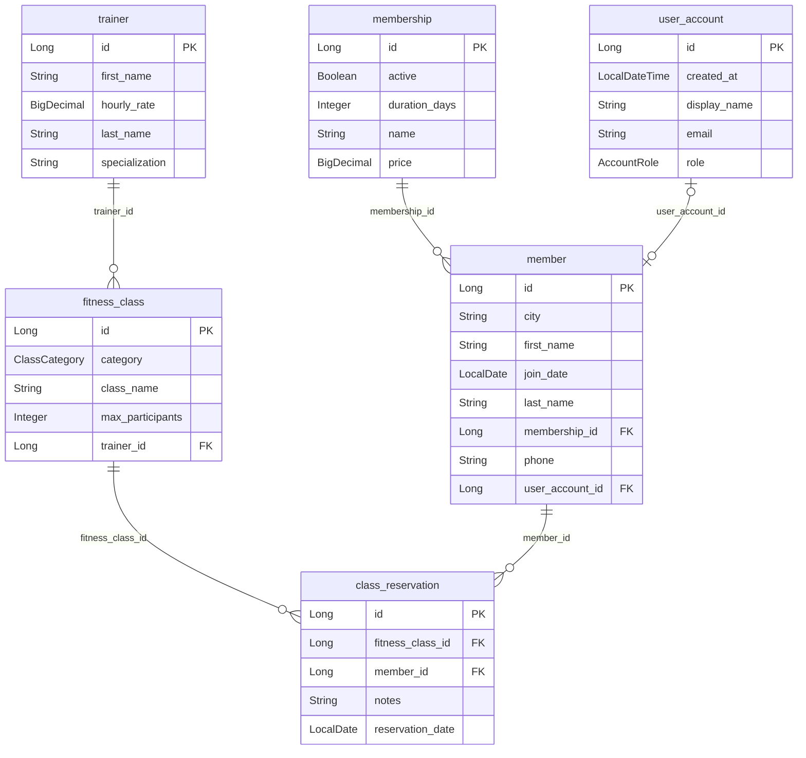

# Schemat bazy danych

Plik generują reguły projektu (panel Maven → Lifecycle → verify). Nie edytujcie go ręcznie.

Tabele: 6 · kolumny: 33 · relacje: 4 × @ManyToOne, 1 × @OneToMany, 1 × @OneToOne, 0 × @ManyToMany

| Tabela | Encja | Kolumny | Klucze obce |
|---|---|---|---|
| class_reservation | ClassReservation | 5 | fitness_class_id, member_id |
| fitness_class | FitnessClass | 5 | trainer_id |
| member | Member | 8 | membership_id, user_account_id |
| membership | Membership | 5 | — |
| trainer | Trainer | 5 | — |
| user_account | UserAccount | 5 | — |

